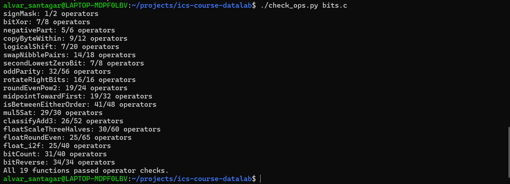
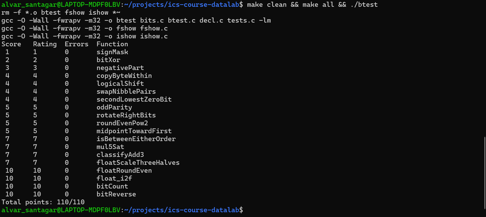

# ICS Lab1 DataLab 实验报告

###### --- 执行 `./check_ops.py bits.c` 后的截图 ---

###### --- 执行 `./btest` 后的截图 ---

## 解题思路
1. **signMask**： 使用左移运算把 1 移动到第 32 位。

2. **bitXor**：仅有按位与、按位非运算可用。根据 $a \oplus b = (a\vee b) \wedge \lnot (a \wedge b) = \lnot(\lnot a \wedge \lnot b)\wedge \lnot (a \wedge b)$ 可得结果。

3. **negativePart**：观察到 `x >> 31` 的结果对于负数是 -1（全为 1），对于非负数是 0。又根据补码的原理，有 `-x == (~x) + 1`。所以本题答案即为 `(x >> 31) & ((~x) + 1)`。实际使用了更为复杂的方法，利用 `~(x >> 31)` 对于非负的 x 值为 -1 的性质，同样得到了统一的表达式。注意对于 INT_MIN 取负后仍为 INT_MIN。

4. **copyByteWithin**：每个字节占 8 位，因此先用 `src << 3` 和 `dst << 3` 计算字节编号对应的偏移量。将 `x` 右移使源字节位于最低字节的位置，再与 `0xff` 进行与运算提取源字节；随后将其左移到目标位置。最后利用目标字节掩码清空原来的目标字节，再用按位或填入源字节，保留其他字节不变。

5. **logicalShift**：算术右移和逻辑右移的区别在于高位的填充方式，因此可以先进行算术右移，再用掩码清除高位补出的 1。将 `1 << 31` 算术右移 `n` 位，会得到最高 `n + 1` 位为 1 的数；对其取反、左移 1 位并与 `1` 按位或，即得到低 `32 - n` 位为 1 的掩码。将这个掩码与 `x >> n` 相与即可，`n = 0` 时也成立。

6. **swapNibblePairs**：分别构造 `0xf0f0f0f0` 和 `0x0f0f0f0f` 用作掩码，提取每个字节的高 4 位和低 4 位。将高 4 位右移 4 位，将低 4 位左移 4 位，再按位或合并。由于算术右移可能在最高位补 1，右移结果还需要与低半字节掩码相与，清除这些额外的位。

7. **secondLowestZeroBit**：`v & ((~v) + 1)` 可以得到 `v` 最低的一个 1。先将 `x` 取反，使原来的 0 变为 1，再提取并用异或清除最低的一个 1。对剩余部分再次提取最低的一个 1，其位置就是原数第二低的 0。如果原数不足两个 0，最终结果自然为 0。

8. **oddParity**：先构造 `0x11111111`，使每个半字节只有最低位为 1。将 `x` 分别右移 0、1、2、3 位后应用这个掩码，再异或起来，就能把每个半字节的奇偶性集中到该半字节的最低位。随后将结果分别右移 4 的倍数并异或，得到所有 32 位的总奇偶性。最后取最低位并使用 `!`，使 1 的个数为偶数时返回 1，为奇数时返回 0。

9. **rotateRightBits**：循环移动 32 位会回到原值，因此先用 `n & 31` 将移动量限制为 0～31。利用掩码将 `x` 分成最低的 `n` 位和剩余高位：低位部分需要移动到最高处，高位部分需要右移到最低处。由于不能右移或左移 32 位，将左移 `32 - n` 位拆成左移 `31 ^ n` 位、再左移 1 位；其中 `31 ^ n` 在这个范围内等于 `31 - n`。最后清除算术右移补出的高位 1，再合并两部分。

10. **roundEvenPow2**：将 `x` 分成商 `x_high = x >> n` 和低 `n` 位余数。余数的最高位可以判断余数是否至少达到一半，因此先计算 `x_high + keybit`，得到把恰好一半也向上舍入的商。然后用 `!` 和异或判断余数是否恰好为 `2^(n - 1)`；如果恰好一半且原商为偶数，就将刚才加上的 1 减去。最后左移 `n` 位，恢复成 `2^n` 的倍数。

11. **midpointTowardFirst**：中点可以写成 $x + \text{trunc}((y-x)/2)$，其中截断方向为趋向 0，这样半整数就会向第一个参数 `x` 靠近。直接计算 `y - x` 可能溢出，因此用高 32 位和最低 1 位模拟 33 位整数来计算，并分别处理低位加法及其进位。得到的 `sum_high` 相当于差值除以 2 后向下取整；当差值为负数且为奇数时，再加 1，使其改为向 0 截断。最后加回 `x` 即可。

12. **isBetweenEitherOrder**：无论端点顺序如何，`x` 在区间外，当且仅当 `a - x` 和 `x - b` 都不为 0，且二者符号不同。由于差值可能溢出，分别用高部和最低 1 位模拟两个 33 位差值。利用高部和低位共同判断差值是否为 0，再通过高部的符号位判断符号是否不同。最后将“两个差值均非零且符号不同”的条件取反，得到包含两个端点的区间判断结果。

13. **mul5Sat**：利用 `x * 5 = x * 4 + x`，但直接移位、相加可能丢失溢出信息，因此将结果拆成最低 3 位和其余高位，模拟 35 位整数。分别计算两部分，并将低位加法产生的进位加入高部。检查完整结果的最高 4 位：若全为 0 或全为 1，则这些位符合符号扩展，结果可以用 32 位有符号整数表示；否则发生溢出。最后通过掩码选择正常乘积，或者根据 `x` 的符号选择 `INT_MAX`、`INT_MIN`。

14. **classifyAdd3**：三个 32 位有符号整数的精确和可能需要 34 位，因此将每个数拆成最低 2 位和其余高位。先累加低位，将产生的进位加入高部，得到精确和的高部。检查完整结果的最高 3 位是否全为 0 或全为 1：若是，说明结果仍在 32 位有符号整数范围内，返回 0；否则根据精确和的符号，正溢出返回 1，负溢出返回 -1。

15. **floatScaleThreeHalves**：先拆出符号位、指数域和小数域；对于 NaN 和无穷大，直接返回原值。对于非规格化数，直接将小数域乘以 3、除以 2，并进行舍入；若结果达到规格化数的范围，就将指数域设为 1。对于规格化数，先补上隐含的最高位 1，再进行同样的计算；若舍入后的有效数达到 `0x1000000`，就增加指数，并再次右移 1 位、舍入。每次右移 1 位时，只有原数最低两位为 `11` 才需要向上舍入，从而实现恰好一半时取偶数。若指数增至 255，则返回同符号的无穷大；符号位始终保留，因此也保留了正零和负零。

16. **floatRoundEven**：设指数域为 `exp`。当 `exp >= 150` 时，所有有限值已经是整数，而 NaN、无穷大也应保持不变，所以直接返回原值。当 `exp < 126` 时，绝对值小于 0.5，返回保留符号的零。当 `exp == 126` 时，绝对值位于 `[0.5, 1)`：小数域为 0 表示恰好 0.5，应舍入到偶数 0；否则舍入到同符号的 1。其余情况的绝对值位于 `[1, 2^23)`，利用掩码定位表示 0.5 的位和更低的小数位：小数部分大于 0.5，或等于 0.5 且整数部分为奇数时，进行向上舍入。判断奇偶性时，指数域为 127 的情况需要单独考虑，因为整数部分的 1 来自隐含位。最后清除所有小数位，处理有效数进位，并保留符号。

17. **float_i2f**：先处理零，再提取符号，并用无符号运算取得绝对值，这样也能正确表示 `INT_MIN` 的大小。不断右移绝对值，找到最高一个 1 的位置，确定指数。若最高位位置不超过 23，则可以通过左移完整保留所有有效位；否则右移，只保留包括隐含位在内的 24 位有效数。根据最高被舍弃位、更低被舍弃位是否非零，以及保留部分的最低位是否为奇数，完成最近偶数舍入。若舍入产生额外进位，就右移有效数并增加指数，最后拼接符号位、指数域和小数域。

18. **bitCount**：构造 `0x55555555`、`0x33333333` 和 `0x0f0f0f0f` 三个掩码，逐级统计每个 2 位、4 位、8 位分组中 1 的数量。每一级都把相邻两个分组的计数移到对应位置，再相加。最终每个字节保存该字节的计数，将这四个字节的计数通过右移和相加集中到最低字节，再与 `0xff` 相与，得到整个整数中 1 的数量。

19. **bitReverse**：初始思路与第 18 题类似，但由于操作符限制非常严格，需要先从 `0x0000ffff` 出发，通过移位和异或构造字节、半字节、2 位和单个位的交替掩码。利用这些掩码依次交换相邻的 1 位、2 位、4 位、8 位分组，最后交换高低 16 位，便完成整个 32 位整数的位序反转。每次右移后应用掩码，也能清除算术右移补出的高位 1。